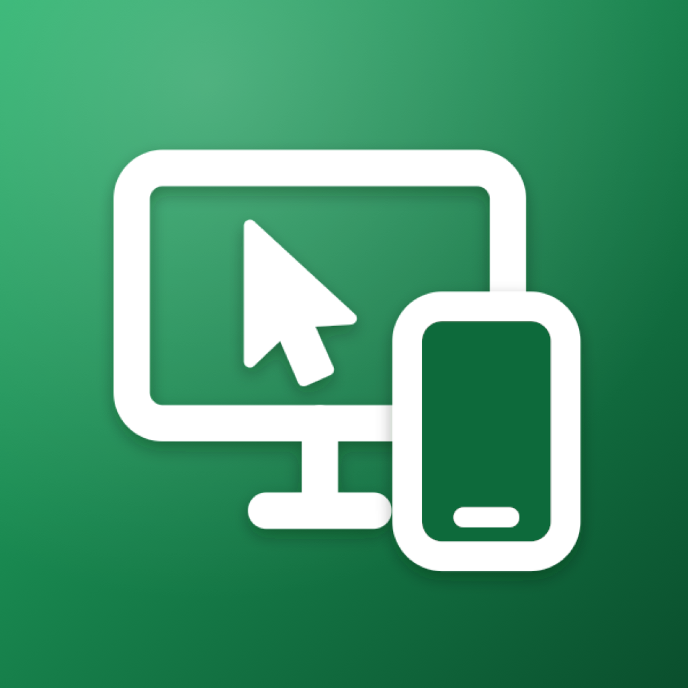

<p align="center">
  
</p>

<h1 align="center">Relais Distant</h1>

<p align="center">
  Contrôle ton Mac depuis n'importe où : ton iPhone, ton iPad, ton PC, ou l'ordinateur d'un ami.<br>
  Libre, gratuit et sans publicité. Une alternative simple à RustDesk, TeamViewer ou AnyDesk.
</p>

<p align="center">
  <a href="https://github.com/ayzak2006/relais-distant/releases/latest">Télécharger</a> ·
  <a href="docs/MODE-EMPLOI.md">Mode d'emploi</a> ·
  <a href="https://relais-distant.relais-distant-worker.workers.dev">Version web</a>
</p>

---

## Pourquoi Relais Distant

- **Un compte, tous tes appareils.** Connecte tes appareils une fois : ils apparaissent dans « Mes appareils ». Une touche suffit pour en prendre le contrôle.
- **Chez un ami, rien à installer.** Ouvre la version web sur son ordinateur, scanne le QR code avec ton téléphone : l'accès dure 12 heures au plus et s'efface à la fermeture.
- **Pas de code à retenir.** Pour connecter un appareil : un QR code, ou un code à usage unique de 6 caractères.
- **Rapide et léger.** Agent Mac natif en Rust (4,5 Mo), encodage H.264 matériel, environ 2 % de processeur en 1920×1200.
- **Privé.** L'écran, le clavier et la souris passent en direct entre tes appareils (WebRTC chiffré). Le relais ne fait que les mettre en relation.

## Installer

| Appareil | Rôle | Comment |
|---|---|---|
| **Mac** | Contrôlé et contrôleur | Télécharge **Relais Distant Agent** (pour être contrôlé) et **Relais Distant** (pour contrôler) depuis les [versions publiées](https://github.com/ayzak2006/relais-distant/releases/latest). |
| **iPhone, iPad** | Contrôleur | App Store (en cours de validation par Apple) ou TestFlight. |
| **PC Windows** | Contrôleur | `Relais-Distant_x64-setup.exe` ou `.msi` dans les [versions publiées](https://github.com/ayzak2006/relais-distant/releases/latest). |
| **PC Linux** | Contrôleur | `.AppImage` ou `.deb` dans les [versions publiées](https://github.com/ayzak2006/relais-distant/releases/latest). |
| **Android** | Contrôleur | `.apk` dans les [versions publiées](https://github.com/ayzak2006/relais-distant/releases/latest). |
| **N'importe quel navigateur** | Contrôleur | [relais-distant.relais-distant-worker.workers.dev](https://relais-distant.relais-distant-worker.workers.dev) |

Pour l'instant, seul le **Mac** peut être contrôlé. Les agents Windows, Linux et Android sont prévus. L'iPhone et l'iPad ne pourront jamais être contrôlés : Apple ne le permet pas aux apps.

### Premier lancement sur Mac

1. Glisse **Relais Distant Agent** et **Relais Distant** dans le dossier Applications, puis ouvre-les.
2. macOS demande deux autorisations pour l'agent : **Enregistrement de l'écran** et **Accessibilité**. Accepte, puis quitte et rouvre l'agent.
3. Dans l'app **Relais Distant**, choisis **Connexion permanente** et crée ton compte. L'agent se connecte automatiquement au même compte : ton Mac est prêt.

Les versions publiées ici ne sont pas notariées par Apple. Au premier lancement, fais un clic droit sur l'app, puis **Ouvrir**.

Le guide complet est dans le [mode d'emploi](docs/MODE-EMPLOI.md).

## Comment ça marche

```
 Ton iPhone / PC / navigateur ──── WebRTC direct, chiffré ────▶ Ton Mac (agent)
              │                                                      │
              └──────────── relais (comptes et mise en relation) ◀───┘
```

| Dossier | Contenu |
|---|---|
| `host/` | Agent macOS en Rust : capture ScreenCaptureKit, encodage VideoToolbox, WebRTC, souris et clavier (CGEvent), menu de la barre des menus |
| `app/` | App cliente Tauri 2 (iPhone, iPad, Mac, Windows, Linux, Android) |
| `web/` | Interface partagée : version web, page téléphone, session à distance, gestes tactiles |
| `relay-worker/` | Relais sur Cloudflare Workers : comptes, appareils, codes à usage unique, signalisation |
| `branding/` | Logo |
| `docs/` | Mode d'emploi, fiche App Store |

## Héberger ton propre relais

Le relais public est gratuit, mais tu peux héberger le tien sur un compte Cloudflare gratuit :

```sh
cd relay-worker && npm ci
npx wrangler login
npx wrangler deploy
```

Dans l'app, ouvre **Mon compte**, puis **Serveur relais**, et indique ton adresse. Dans l'agent, utilise le menu **Serveur relais…**.

## Compiler

```sh
./scripts/bundle-mac.sh                 # agent Mac → /Applications/Relais Distant Agent.app
cd app && npm ci && npx tauri build     # app de l'ordinateur courant
npx tauri ios build                     # iPhone et iPad
cd host && cargo test                   # tests de l'agent
```

Le workflow `.github/workflows/apps.yml` compile Windows, Linux, macOS, Android et l'agent Mac à chaque version `v*`, et publie les fichiers dans les versions GitHub.

## Sécurité

- Mots de passe : empreinte PBKDF2-SHA256 avec sel. Le mot de passe n'est jamais stocké en clair. Depuis un appareil connecté en permanent, on peut le changer sans connaître l'ancien.
- Connexions : jetons aléatoires stockés sous forme d'empreinte. Les connexions temporaires expirent au bout de 12 heures, et un appareil retiré perd son accès immédiatement.
- Codes à usage unique : 6 caractères, valables 10 minutes. Au-delà de 12 essais par minute, les tentatives sont bloquées.
- Une connexion temporaire ne peut ni autoriser d'autres appareils ni changer le mot de passe.
- C'est le relais qui gère les comptes, comme chez TeamViewer ou AnyDesk. Si tu veux en garder le contrôle complet, héberge le tien.

## Licence

[MIT](LICENSE) © 2026 Aymen Derbali
